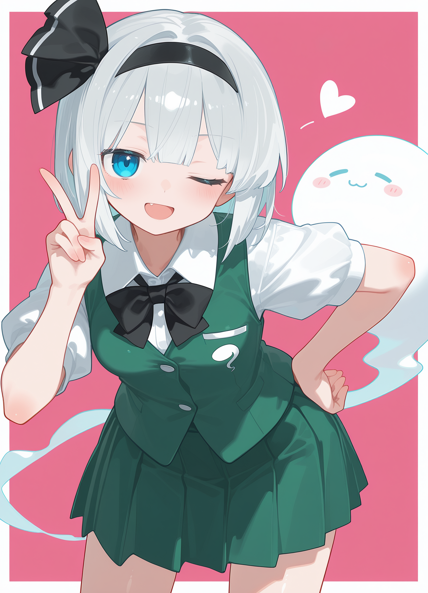
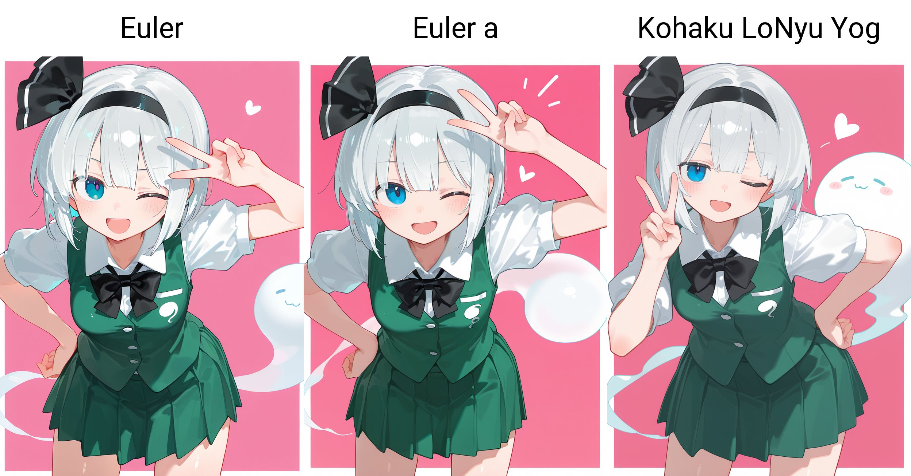
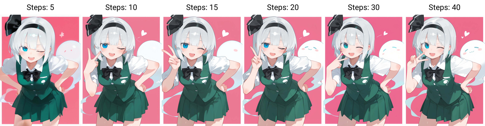

# Stable Diffusion Anime Style Lab

**Myon_style · NeoForge SDXL Image Generation Workflow**

A personal anime-style image generation project built around **Stable Diffusion WebUI NeoForge** and the **WAI-illustrious-SDX / Illustrious SDXL** model family. The focus is a structured, style-oriented generation workflow, supported by practical parameter comparisons and optional image refinement.

> **Scope:** This repository documents a personal workflow and visual experiments. It does not claim a new diffusion algorithm or a completed, self-trained model.

## 1. Myon_style — Visual Goal

**Myon_style** is the name I use for my preferred visual style: **cute anime portraits, soft cel shading, clean line art, expressive faces, and minimal graphic backgrounds**. I prioritize the character's face, silhouette, and cohesive shading over complex scenery.

<p align="center">
  
</p>

The current visual result uses a **Signature Style Preset** consisting of artist-style tags and the existing [nyalia (Illustrious) LoRA](https://civitai.com/models/834822/nyalia-illustrious) at weight `0.6`. The exact preset is in [`style/signature-style.txt`](style/signature-style.txt).

**Naming distinction:** `Myon_style` names my visual style. A separate personal **Myon_style LoRA** is currently being trained and is **not** the LoRA used to produce the published examples.

## 2. NeoForge SDXL Workflow

The workflow follows six stages:

```text
1. Model Setup           Checkpoint + built-in/default VAE + extensions
          ↓
2. Prompt Construction   Quality tags + six-part prompt + Signature Style Preset
          ↓
3. Sampling Setup        Kohaku LoNyu Yog + Karras + Steps + CFG
          ↓
4. Base Generation       Portrait resolution + seed + txt2img
          ↓
5. Optional Refinement   ADetailer / Hires.fix (as needed)
          ↓
6. Visual Evaluation     Structure + linework + shading + style consistency
```

For the detailed sequence, choices, and caveats, see [`docs/workflow.md`](docs/workflow.md). For the positive/negative prompt examples and six-part layout, see [`docs/prompt-structure.md`](docs/prompt-structure.md).

## 3. Current Personal Configuration

| Setting | My current workflow |
| --- | --- |
| Interface | **Stable Diffusion WebUI NeoForge** |
| Checkpoint family | **WAI-illustrious-SDX / WAI-Illustrious (SDXL-based)** |
| Model compatibility | In my own workflow, **WAI-Illustrious versions above 15.0** can be used; image results may vary by version |
| VAE | Using the VAE configuration provided by the checkpoint/default setup; no separate VAE selection is required in my current workflow |
| Base portrait resolution | **896 × 1152** (latest confirmed default) |
| Sampler / Scheduler | **Kohaku LoNyu Yog / Karras** |
| Sampling steps | **30 preferred** for everyday use; **20** recorded for the Showcase reference |
| CFG scale | **3.5 preferred** |
| Prompt style | Six functional blocks separated with `BREAK` |
| Existing style LoRA | **nyalia**, weight `0.6` (not the in-training Myon_style LoRA) |
| ADetailer / Hires.fix | Optional refinement stages |

For optional Hires.fix, my documented UI settings include **2× upscale**, **12 Hires steps**, **0.2 denoising**, and **Hires CFG 3**. They are preferences, not requirements for the Myon_style look.

**Reference vs current settings:** The previously published Showcase/test record names `waiNSFWIllustrious_v150`, **20 steps**, CFG **3.5**, and seed `2601892452`. That historical reference is preserved in [`configs/baseline.yaml`](configs/baseline.yaml). My latest confirmed **896 × 1152** base resolution supersedes an earlier **832 × 1152** personal-settings screenshot; the exported Showcase image has no readable generation metadata, so its original base dimensions cannot be independently recovered from that export.

## 4. Visual Experiments

These are **personal visual comparisons**, not quantitative benchmarks. The published grids use the same author-confirmed reference setup except for the deliberately varied setting.

### Sampler — Euler / Euler a / Kohaku LoNyu Yog



Euler has color artifacts near hair edges and less distinct layering; Euler a produces less orderly hair shading. Both show some character-structure issues. **Kohaku LoNyu Yog** gives my preferred overall result in this example.

Sampler implementation: [Koishi-Star/Euler-Smea-Dyn-Sampler](https://github.com/Koishi-Star/Euler-Smea-Dyn-Sampler).

### Sampling Steps — 5 / 10 / 15 / 20 / 30 / 40



Lower step counts look less resolved in parts of the image. **30 steps** is my current preference, while the Showcase reference used **20 steps**.

### CFG Scale — 1.0 to 6.0

Below **3.5**, the image appears grayer and loses some characteristic detail. Higher CFG values strengthen the outlines; **3.5** is my preferred balance, although higher values can also work.

*CFG grid image is not yet in the repository; the intended path is `examples/comparisons/cfg-comparison.jpg`.*

### ADetailer — Existing Initial Comparison


An initial example is **already included**. It compares images labeled with detector `None` and `99coins_anime_girl_face_m_seg.pt`. Full detector, mask, and inpainting settings for a rigorously documented matched OFF/ON test are not yet recorded. ADetailer is an optional part of the workflow.

Further notes: [`docs/comparisons.md`](docs/comparisons.md).

## 5. Documentation

| File | Purpose |
| --- | --- |
| [`docs/workflow.md`](docs/workflow.md) | Full NeoForge SDXL generation sequence and configuration distinctions |
| [`docs/prompt-structure.md`](docs/prompt-structure.md) | Six-part prompt layout and original positive/negative examples |
| [`docs/comparisons.md`](docs/comparisons.md) | Detailed sampler, step, CFG, and ADetailer observations |
| [`style/signature-style.txt`](style/signature-style.txt) | Reusable current style preset (artist tags + nyalia) |
| [`configs/baseline.yaml`](configs/baseline.yaml) | Historical Showcase/comparison reference |
| [`configs/personal-preferences.md`](configs/personal-preferences.md) | Earlier recorded personal UI settings; see latest 896 × 1152 update above |
| [`experiments/lora-training.md`](experiments/lora-training.md) | **Myon_style LoRA training — in progress**, no released checkpoint yet |

## 6. Project History & Ongoing Experiments

I began putting this personal workflow into practice in **July 2025** and only **recently organized and uploaded** the material to GitHub.

My personal **Myon_style LoRA** is **in training**. It belongs to the project's future **Experiments** workstream; no trained weights, performance results, or completed model are claimed here. Training notes and planned documentation are tracked in [`experiments/lora-training.md`](experiments/lora-training.md).

The current priority is documenting a clear **NeoForge + SDXL workflow**, with honest separation between the established generation setup, existing visual comparisons, and experiments still in progress.
