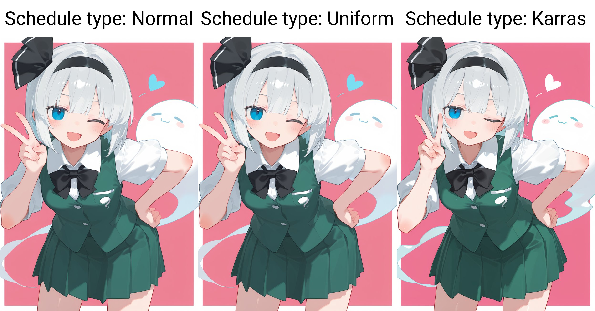

# Stylized Anime Portrait Generation Workflow

A personal Stable Diffusion WebUI NeoForge workflow for a consistent anime portrait aesthetic. **V0.1 is a temporary showcase** of the current style preset, selected settings, example outputs, and practical limitations.

## 1. Project Overview

This project documents how I use Stable Diffusion WebUI NeoForge to generate character-focused anime portraits and illustrations. It presents a practical image-generation workflow centered on my preferred visual style. It does not claim new diffusion algorithms, model training, or general performance improvements.

## 2. Style Overview

**Cute Anime Portrait / Soft Cel Shading / Clean Line Art / Minimal Graphic Background**

The workflow is intended for portraits, character illustrations, and simple graphic backgrounds. It prioritizes a clear character focal point and a polished, stylized finish.

## 3. Signature Style Preset

The style is defined by one fixed combination of artist tags and a style LoRA. The full block is treated as a single **Signature Style Preset**; this version does not attribute effects to individual tags or include tag ablation experiments.

```text
artist:tianliang duohe fangdongye,
(kanpa \(campagne 9\):0.8),
(alpha \(alpha91\):0.6),
(koyama shigeru:0.6),
(massakasama:0.55),
<lora:nyalia:0.6>
```

The reusable text file is [`style/signature-style.txt`](style/signature-style.txt).

## 4. Style Showcase

<p align="center">
  
</p>

This is the representative style example. Its embedded metadata records `waiNSFWIllustrious_v150`, 20 steps, Kohaku LoNyu Yog + Karras, CFG 3.5, and `nyalia` at 0.6. It also records ADetailer and a 2× Hires pass using `4xNMKDSuperscale` (20 Hires steps, CFG 3). These are the settings for this image; the documented 30-step baseline below comes from a separate source PNG.

## 5. Sampler Comparison

<p align="center">
  
</p>

The grid compares **Euler**, **Euler a**, and **Kohaku LoNyu Yog**. The images also differ in pose, composition, and details, so this is a practical visual comparison rather than a controlled test. In my use, **Kohaku LoNyu Yog + Karras** is my preference for the line clarity, overall cleanliness, and visual result in this style. This is a personal observation, not a claim that it is universally better.

Kohaku LoNyu Yog is provided by [Koishi-Star/Euler-Smea-Dyn-Sampler](https://github.com/Koishi-Star/Euler-Smea-Dyn-Sampler).

### Scheduler Comparison

<p align="center">
  
</p>

The grid compares **Normal**, **Uniform**, and **Karras** from left to right. Its embedded X/Y/Z metadata lists schedule type as the varied axis with Kohaku LoNyu Yog, 20 steps, CFG 3.5, seed `2601892452`, and `waiNSFWIllustrious_v150`. Normal and Uniform show similar poses, while Karras changes the hand gesture and small background details. **Karras remains my preference** for the overall look in this example. One grid does not establish a general ranking, and composition changes make specific line-quality differences difficult to attribute.

## 6. Sampling Steps Comparison

<p align="center">
  
</p>

The grid shows **5, 10, 15, 20, 30, and 40 steps**. In this example, the lower-step images appear less resolved, while more detail is visible at higher step counts; pose and small details vary across panels. **30 steps is my current preference**, not a mathematically optimal value or a universal recommendation.

## 7. Workflow Configuration

| Parameter | Recorded setting | Verification |
| --- | --- | --- |
| Interface | Stable Diffusion WebUI NeoForge | Verified in source PNG metadata (`neo-2.26`) |
| Checkpoint | `reedXXXIllustrious_v160` (`dd984164e4`) | Verified in the recorded 30-step baseline PNG metadata |
| Sampler | Kohaku LoNyu Yog | Verified in baseline PNG metadata |
| Scheduler | Karras | Verified in baseline PNG metadata |
| Steps | 30 | Verified in baseline PNG metadata; personal working setting |
| CFG scale | 3.5 | Verified in baseline PNG metadata |
| Style LoRA | `nyalia`, weight 0.6 | Verified in baseline PNG metadata |
| VAE module | `sdxl_vae` | Verified in baseline PNG metadata |

The source image for this baseline is `00036-1872344064.png` (832 × 1152; seed `1872344064`). The source image is not redistributed here. The Showcase image uses a different checkpoint and 20 steps, as noted above. See [`configs/baseline.yaml`](configs/baseline.yaml) for the recorded fields and remaining TODOs.

## 8. Practical Experience & Limitations

- The checkpoint's original facial details do not always meet my preference, so I often use ADetailer for face refinement.
- Complex backgrounds can produce inconsistent results in my use. This workflow therefore focuses on simple backgrounds and character-centered compositions.
- High-resolution refinement can improve some details, but it is an **optional refinement**, not a defining part of the style.
- The Signature Style Preset is the main style definition; high-resolution generation alone does not define the look.

## 9. Planned Comparisons

The following additions remain **Planned / TODO**. No results are implied by these placeholders.

- **ADetailer OFF vs ON:** a further matched comparison with documented settings; the current example is shown in [`examples/adetailer-comparison.jpg`](examples/adetailer-comparison.jpg).
- **Optional Hires.fix Comparison:** identify the refinement method and compare the same source image.
- **Additional Style Showcase Images:** add more representative examples.

See [`docs/comparisons.md`](docs/comparisons.md) for the comparison notes.

## 10. Reproduction Guide

1. Install a compatible Stable Diffusion WebUI NeoForge version.
2. Obtain a compatible checkpoint, VAE, and the `nyalia` LoRA from their original authorized sources. This repository does not redistribute model weights.
3. Install the [Euler-Smea-Dyn-Sampler extension](https://github.com/Koishi-Star/Euler-Smea-Dyn-Sampler) using its upstream instructions, then select **Kohaku LoNyu Yog**.
4. Enter the Signature Style Preset from [`style/signature-style.txt`](style/signature-style.txt) as one block in the positive prompt.
5. For the recorded baseline, set **Karras**, **30 steps**, **CFG 3.5**, and `nyalia` at **0.6**. Select `reedXXXIllustrious_v160` if you have the same checkpoint available.
6. Use ADetailer when face refinement is needed. Treat high-resolution refinement as optional and record its settings separately.

Checkpoint and extension availability can change; check their original sources for licensing and compatibility. Exact output may vary with software versions and generation environment.
