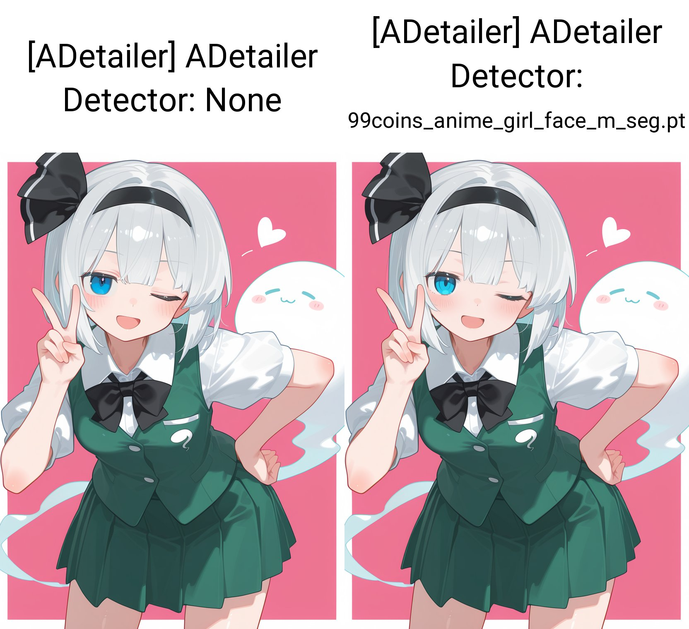

# Comparison Notes — Showcase Reference

These are **personal visual comparisons**, not statistically controlled benchmarks or claims of general sampler superiority.

## Common reference setup

The author confirms that the test images use the same Showcase1 reference configuration unless a parameter is explicitly varied:

| Item | Value |
| --- | --- |
| Checkpoint | `waiNSFWIllustrious_v150` |
| Sampler | Kohaku LoNyu Yog (varied in sampler grid) |
| Scheduler | Karras |
| Steps | 20 (varied in steps grid) |
| CFG scale | 3.5 |
| Seed | `2601892452` |
| Style | Fixed Signature Style Preset with `nyalia:0.6` |

These values are based on the author's confirmation and earlier repository documentation. The newly uploaded Showcase export has **no readable PNG generation metadata**. Do not describe these parameters as extracted from that file.

## Sampler: Euler / Euler a / Kohaku LoNyu Yog

**Euler** shows unusual color patches along the hair edges and less distinct layering. **Euler a** has cluttered highlights and shadows in the hair. Both show some character-structure issues. **Kohaku LoNyu Yog** looks cleaner overall, with more coherent structure and lighting, and remains the author's preference for this style.

[Sampler source](https://github.com/Koishi-Star/Euler-Smea-Dyn-Sampler).

## Steps: 5 / 10 / 15 / 20 / 30 / 40

The grid intentionally varies only the step setting according to the author's test design. Outputs develop different fine details and occasionally shift local features as steps increase. The Showcase reference uses 20 steps; **30 steps remains the author's preferred working setting** for this style. This preference does not establish an optimum.

## Face refinement (ADetailer)

The existing example labels the left output with detector `None` and the right output with `99coins_anime_girl_face_m_seg.pt`. It illustrates the use of targeted face refinement. A more complete comparison with recorded detector, mask, denoising, inpainting, and prompt settings remains planned.

## Planned additions

- A further matched ADetailer OFF/ON comparison with complete settings
- Optional high-resolution refinement before/after, using the same source image
- Additional Signature Style Showcase examples

## Method notes

Only draw conclusions from visible examples and accurately recorded parameters. When testing a single variable, keep all other adjustable settings as consistent as possible. The same random seed does not force two sampling algorithms to produce the same pose or composition. Avoid inventing quantitative improvements.
